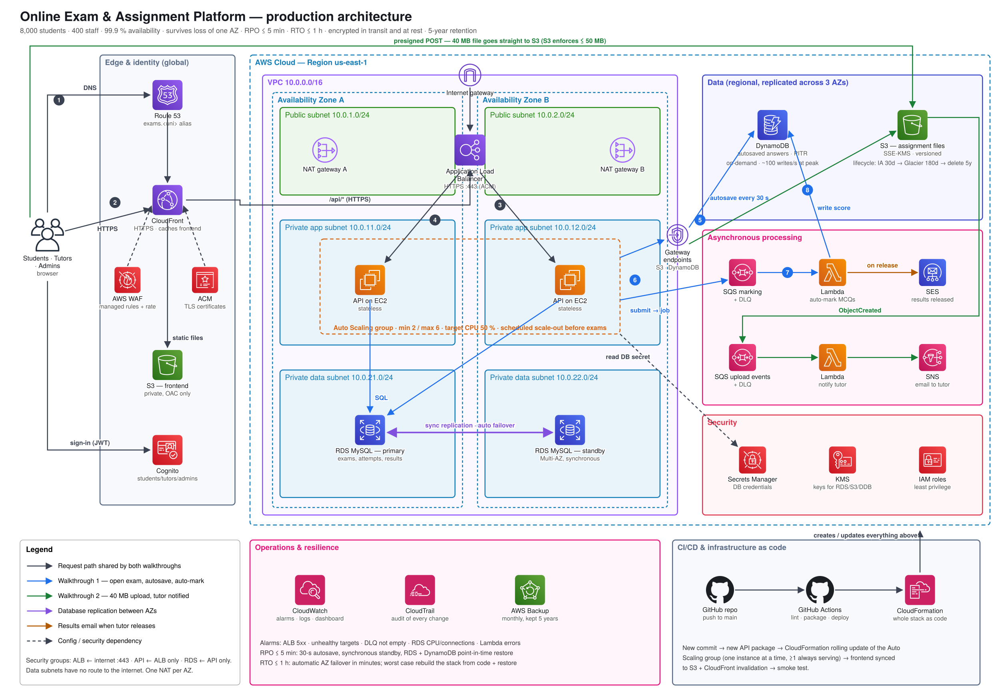

# Online Exam & Assignment Platform on AWS

DSO303 Assignment 2. A cloud architecture for a university of **8,000 students and 400 staff** that runs timed exams and assignment submissions online. The whole platform is defined in code and redeploys automatically on every push to `main`.

| | |
|---|---|
| Architecture + walkthroughs | [`architecture/README.md`](architecture/README.md) |
| Service table | [`docs/services.md`](docs/services.md) |
| Infrastructure as code | [`infra/template.yaml`](infra/template.yaml) (CloudFormation) |
| CI/CD | [`.github/workflows/deploy.yml`](.github/workflows/deploy.yml) |
| Evidence | [`evidence/`](evidence/) |
| Editable diagram | [`architecture/architecture.svg`](architecture/architecture.svg) |



## Summary

- **Two Availability Zones** for every tier: public subnets (ALB, NAT per AZ), private app subnets (Auto Scaling API on EC2), private data subnets (RDS MySQL Multi-AZ).
- **Edge:** CloudFront serves the frontend from a private S3 bucket and proxies `/api/*` to the ALB. Optional AWS WAF; Route 53 + ACM in production.
- **Exams:** server-side timer, answers **autosaved every 30 s** to DynamoDB, MCQs **auto-marked** asynchronously (SQS → Lambda).
- **Uploads:** PDF/ZIP up to 50 MB go **straight to S3** using presigned POST (S3 enforces the size limit). S3 events → SQS → Lambda → **email to the tutor** via SNS.
- **Targets:** 99.9 % availability, survives one AZ, RPO ≤ 5 min, RTO ≤ 1 h, encryption in transit and at rest, 5-year retention with S3 lifecycle rules.

## Repository layout

```
app/api/            Flask API (runs on EC2 via gunicorn)
frontend/           Single-page web app (student, tutor views)
infra/template.yaml Entire platform as one CloudFormation stack
.github/workflows/  Pipeline: lint → package → deploy → publish frontend → smoke test
scripts/            watch.sh, simulate-az-failure.sh, restore-az.sh, teardown.sh
architecture/       Diagram + the two request walkthroughs + peak/AZ reasoning
docs/services.md    Every service: role, why over an alternative, config, connections
evidence/           Cloud Architecture Lab image
```

## Deploy (from code)

Everything is in `infra/template.yaml` and `.github/workflows/deploy.yml`, so the platform can be rebuilt from scratch with no console clicking.

1. In GitHub go to *Settings → Secrets and variables → Actions* and add the secrets `AWS_ACCESS_KEY_ID`, `AWS_SECRET_ACCESS_KEY` and `AWS_SESSION_TOKEN`. You can also add the variables `TUTOR_EMAIL`, `ENABLE_WAF` and `ENABLE_COGNITO`.
2. Push to `main`. The pipeline lints the template and code, uploads the API package (named by commit SHA), runs `cloudformation deploy`, syncs the frontend to S3, invalidates CloudFront and smoke-tests `/api/health`.
3. Every later push does a **rolling replacement** of the API instances (one at a time, at least one always serving), so there's no downtime.

The same steps work by hand:

```bash
ACCOUNT=$(aws sts get-caller-identity --query Account --output text)
BUCKET=exam-platform-artifacts-$ACCOUNT; SHA=$(git rev-parse HEAD)
aws s3 mb s3://$BUCKET 2>/dev/null || true
(cd app/api && zip -qr ../../api.zip .) && aws s3 cp api.zip s3://$BUCKET/app/$SHA/api.zip
aws cloudformation deploy --stack-name exam-platform --template-file infra/template.yaml \
  --parameter-overrides ArtifactBucket=$BUCKET AppVersion=$SHA TutorEmail=you@example.com
```

Once deployed, `scripts/watch.sh` + `scripts/simulate-az-failure.sh` demonstrate an AZ failure (they remove AZ-a from the ASG and force an RDS failover), and `scripts/teardown.sh` deletes everything.

## Template notes

`infra/template.yaml` implements the core of the design: VPC, ALB, ASG, RDS Multi-AZ, DynamoDB, S3, SQS/Lambda, SNS, CloudFront, alarms, plus optional WAF and Cognito. A few production pieces are documented in the design but left out of the template because they need things a student account doesn't have:

- **Route 53 + ACM + HTTPS on the ALB:** these need a registered domain. Until then CloudFront uses its default certificate and talks to the ALB over HTTP.
- **SES:** needs a verified sending domain. The template uses SNS for tutor emails.
- **Per-component IAM roles:** the role names are parameters, defaulting to the AWS Academy `LabRole` / `LabInstanceProfile`.
- **Retention:** `DeletionPolicy: Delete` is set so teardown is clean. Production would use `Snapshot`/`Retain` plus AWS Backup for 5-year retention.
- **API authorisation:** the demo API reads the role from an `X-Demo-Role` header. Production reads it from the Cognito JWT.
# DSO303_A2_02230305
