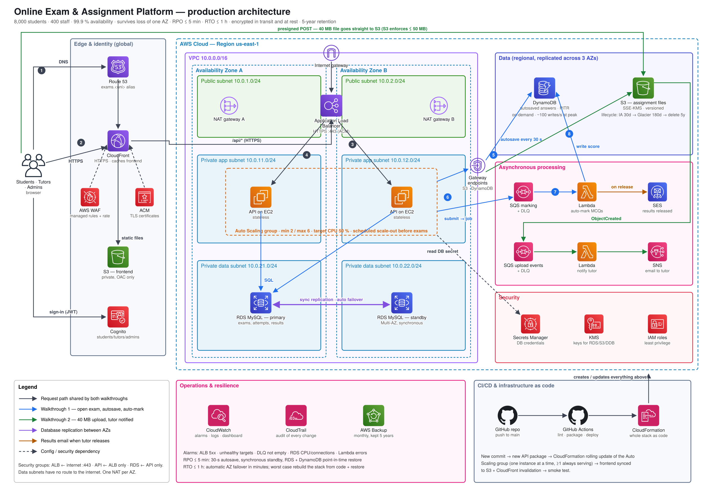
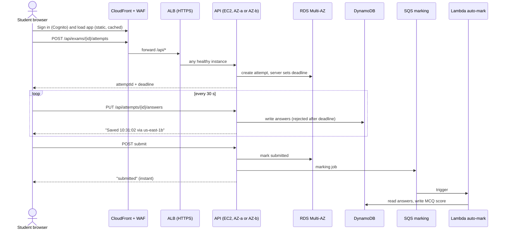
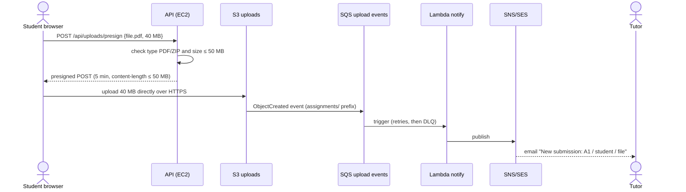

# Architecture

*Editable source: [`architecture.svg`](architecture.svg). The same design as a Cloud Architecture Lab workspace: [`lab-architecture.json`](lab-architecture.json). Numbers ①–⑧ in the diagram match Walkthrough 1. Green arrows show Walkthrough 2.*

Region **us-east-1**, VPC `10.0.0.0/16`, with every tier spread across **two Availability Zones**:

| Tier | AZ-a | AZ-b | Route to internet | Who can reach it |
|---|---|---|---|---|
| Public (ALB, NAT) | 10.0.1.0/24 | 10.0.2.0/24 | Internet Gateway | Internet → ALB :443 only |
| Private app (API on EC2) | 10.0.11.0/24 | 10.0.12.0/24 | NAT gateway **in the same AZ** | ALB security group only |
| Private data (RDS) | 10.0.21.0/24 | 10.0.22.0/24 | **none** | API security group only |

| Layer | Components |
|---|---|
| **Edge** | Route 53 → CloudFront (TLS from ACM) protected by AWS WAF. CloudFront serves the frontend from a private S3 bucket (Origin Access Control) and forwards `/api/*` to the ALB. The browser only talks to one HTTPS origin, so there is no CORS. |
| **Authentication** | Cognito user pool with `students`, `tutors` and `admins` groups. The API checks the `cognito:groups` claim in the JWT: tutors create exams and mark/release results, admins manage users and schedules, students sit exams and upload. |
| **Compute** | ALB (HTTPS :443, ACM cert) in both public subnets → Auto Scaling group (min 2, max 6, spread over both AZs) of stateless API instances in the private app subnets. |
| **Data** | RDS MySQL **Multi-AZ** (users' roles, exams, schedules, attempts, results) · DynamoDB (autosaved answers: high-rate small writes) · S3 (assignment files, versioned, lifecycle IA → Glacier → delete at 5 years). |
| **Async** | SQS queues (each with a dead-letter queue) trigger Lambda workers: auto-marking MCQs and notifying tutors via SNS. Result-release emails to students go through SES. |
| **Security** | KMS encryption at rest on RDS, DynamoDB, S3, SQS and SNS. TLS on every hop that leaves the AWS network. S3 bucket policy denies non-TLS requests. DB password in Secrets Manager. One least-privilege IAM role per component. Gateway endpoints keep S3/DynamoDB traffic off the internet. |
| **Operations** | CloudWatch alarms, logs and dashboard. CloudTrail audit log. AWS Backup with 5-year retention. Everything defined in CloudFormation and deployed by GitHub Actions. |

## How each requirement is met

| Requirement | How the design meets it |
|---|---|
| Role-based sign-in | Cognito groups → JWT `cognito:groups` claim checked by the API on every request |
| Timed MCQ + short-answer exams | Exam start writes an attempt with a **server-set deadline** (RDS). Saves after deadline + 60 s grace are rejected |
| Autosave every 30 s | Browser → `PUT /answers` → DynamoDB (idempotent overwrite per question) |
| Auto-marking of MCQs | Submit → SQS → Lambda compares answers with the key → score stored. Short answers queue for the tutor |
| Uploads PDF/ZIP ≤ 50 MB | Presigned POST straight to S3 with a `content-length-range` condition, so S3 enforces the limit |
| Email when results released | Tutor releases → SQS → Lambda → SES to each student. New submissions → SNS email to the tutor |
| 300–500 users, 3,000 starts in 5 min | CloudFront caching, stateless ASG with scheduled + target-tracking scaling, DynamoDB on-demand, SQS buffering |
| 99.9 % availability | No single-AZ component. The ALB, ASG, RDS, NAT and regional services all survive one AZ |
| Survive loss of one AZ | See the failure table below |
| RPO ≤ 5 min | 30-s autosave. RDS synchronous standby (0 loss on AZ failure). RDS + DynamoDB point-in-time restore (≤ 5 min) for corruption |
| RTO ≤ 1 h | AZ failover is automatic (≈1–2 min for RDS). A full rebuild from CloudFormation plus a restore takes well under an hour |
| Records kept 5 years | S3 lifecycle (expire at 1,825 days). AWS Backup monthly copies of RDS/DynamoDB kept 5 years |
| Encryption in transit and at rest | ACM TLS at CloudFront and the ALB. KMS on every data store |

## What happens if AZ-a fails

| Component | Behaviour when AZ-a goes down | Impact on students |
|---|---|---|
| CloudFront, Route 53, WAF | Global services, unaffected | None |
| ALB | Health checks (every 10 s, 2 failures) stop routing to AZ-a targets | In-flight requests to AZ-a fail. The browser's next autosave retries and succeeds |
| API (Auto Scaling) | ASG launches replacements in AZ-b up to the desired count | Possible slower responses for ~3–5 min while capacity is rebuilt |
| NAT gateway | AZ-b uses its own NAT | None |
| RDS Multi-AZ | Standby in AZ-b is promoted automatically. The DNS endpoint stays the same | ~60–120 s where starts/submits retry. **No committed data lost** |
| DynamoDB, S3, SQS, Lambda, SNS | Regional, replicated across 3 AZs | None. **Autosaved answers stay safe** |
| Health checks | `/api/health` doesn't call the DB, so the RDS failover doesn't make the ALB mark healthy servers as failed | None |

---

## Walkthrough 1: a student opens an exam and answers autosave

1. **①②** The student signs in with Cognito. Route 53 resolves the exam domain to CloudFront, and the static app comes from CloudFront's cache, so the peak doesn't touch the servers for HTML/JS.
2. **③④** `/api/*` goes to the ALB and on to a healthy API instance in either AZ. Starting the exam creates an **attempt** row in RDS. The **server** sets the deadline, so changing the browser clock does nothing.
3. **⑤** Every 30 s the browser sends the current answers. The API writes them to DynamoDB and returns the time and AZ that saved them. If the student refreshes, or their next request lands on another AZ, saved answers reload from DynamoDB, so at most 30 s of typing is ever at risk.
4. **⑥⑦⑧** On submit the API queues a marking job and replies straight away. Lambda marks the MCQs in the background. Short answers wait for the tutor, and results stay hidden until the tutor releases them.

## Walkthrough 2: a student uploads a 40 MB assignment and the tutor is notified

1. The API only signs the request. The 40 MB file goes **straight from the browser to S3** and never passes through the API instances.
2. The presigned POST has a `content-length-range` condition, so **S3 itself refuses anything over 50 MB**, even if someone skips the browser checks.
3. S3 emits an event into SQS. The Notify Lambda emails the tutor through SNS. If the email step fails, SQS retries it, and after 3 failures the message goes to a dead-letter queue (with an alarm) instead of being lost.
4. The object is KMS-encrypted and versioned. Lifecycle rules move it to cheaper storage and delete it after 5 years.

---

## How the design handles the exam peak and the loss of one AZ

**Exam peak (3,000 starts in 5 minutes):** That works out to about 10 starts/s, and then about 100 autosaves/s (3,000 students ÷ 30 s). Static files come from CloudFront's cache, so only API calls reach the ALB. The API is stateless, so Auto Scaling can add instances freely. Target tracking at 50 % CPU handles surprises, and a scheduled scale-out before a known exam window means capacity is already warm. Autosaves go to on-demand DynamoDB, which takes this write rate without any tuning, so RDS only handles the low-rate starts and submits. Marking and emails go through SQS, so a burst of submissions just waits in the queue (Lambda concurrency is capped) instead of slowing exam pages. Uploads go straight to S3, so big files don't use API capacity. The WAF rate limit is set high on purpose because a whole campus may share one public IP.

**Loss of one AZ:** Every tier runs in both AZs. The ALB health-checks targets every 10 s and stops routing to the failed AZ. Auto Scaling replaces the lost instances in the healthy AZ. RDS Multi-AZ promotes its synchronous standby in about 1–2 minutes, so committed data is not lost. DynamoDB, S3, SQS and Lambda are regional across three AZs and are unaffected. Each AZ has its own NAT gateway. Health checks don't touch the database, so a failover doesn't make the ALB mark healthy servers as failed.

**Targets:** RPO ≤ 5 min. Answers are saved every 30 s, RDS replicates synchronously, and point-in-time restore covers corruption. RTO ≤ 1 h. AZ failover is automatic within minutes, and a full rebuild from CloudFormation plus restore fits inside the hour. Running two AZs with no single points of failure supports 99.9 % availability.
