# DSO303 Assignment 2: Report

**Online Exam & Assignment Platform on AWS**

## 1. Introduction

The task was to act as the cloud architect for a university (8,000 students, about 400 staff) moving all exams and assignment submissions online. The platform has to run timed MCQ and short-answer exams, autosave answers every 30 seconds, auto-mark MCQs, accept PDF/ZIP uploads up to 50 MB and email people when results are released. It also has to meet 99.9 % availability, survive the loss of one Availability Zone, lose at most 5 minutes of answers (RPO), be restored within 1 hour (RTO), keep records for 5 years, and encrypt data in transit and at rest.

This report explains what I designed, why, and how I documented and codified it. Section 8 covers the Cloud Architecture Lab build and simulations, and section 9 has the screenshots.

This assignment connects to several DSO303 topics: VPC design and multi-AZ high availability, managed databases, decoupling with queues and serverless, and infrastructure as code with CI/CD.

## 2. Approach

I worked in this order:

1. **Read the requirements as numbers.** "3,000 students start in 5 minutes" works out to about 10 starts per second. Autosave every 30 s for 3,000 students works out to about 100 writes per second. These two numbers drove most of the design choices.
2. **Designed the network first:** a VPC with three tiers of subnets (public, private app, private data) repeated in two AZs.
3. **Placed each service in the right tier** and chose each one against an alternative (section 5).
4. **Traced the two required walkthroughs** through the design to check every step had a component behind it.
5. **Checked the failure cases:** what happens to each component if AZ-a disappears.
6. **Wrote the design as code:** a CloudFormation template, a small API and frontend, and a GitHub Actions pipeline.
7. **Validated** the template and code with linters, locally and in the pipeline.
8. **Built the design in the Cloud Architecture Lab** and simulated both walkthroughs, the exam peak and the loss of each AZ.

## 3. Architecture

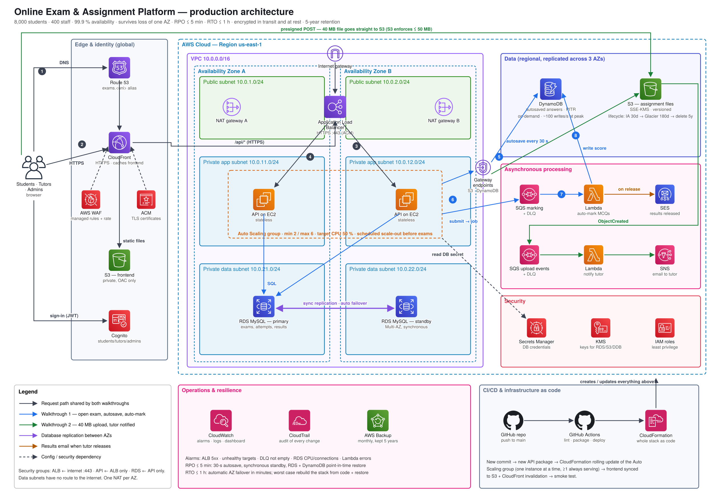

| Layer | What I used | Why |
|---|---|---|
| Edge | Route 53, CloudFront, AWS WAF, ACM | One HTTPS entry point. Static files are cached at the edge so the exam peak doesn't hit the servers. WAF blocks common attacks. |
| Identity | Cognito (students / tutors / admins groups) | Managed sign-in. The API reads the group from the token to enforce roles. |
| Network | VPC across 2 AZs, one NAT gateway per AZ, gateway endpoints | Data subnets have no internet route. Each AZ has its own NAT, so losing one AZ doesn't cut off the other. |
| Compute | ALB + Auto Scaling group of stateless API servers (min 2, max 6) | Stateless servers can be added or replaced in any AZ. |
| Data | RDS MySQL Multi-AZ, DynamoDB, S3 | RDS for relational data with a synchronous standby. DynamoDB for the high-rate autosaves. S3 for files, with lifecycle rules for 5-year retention. |
| Async | SQS (+ dead-letter queues), Lambda, SNS/SES | Marking and emails happen in the background, so a burst of submissions queues up instead of slowing down exam pages. |
| Security | KMS, Secrets Manager, IAM roles, security groups | Encryption at rest everywhere. No passwords in code. Each tier only accepts traffic from the tier in front of it. |
| Operations | CloudWatch, CloudTrail, AWS Backup | Alarms before students notice problems, an audit trail, and long-term backups. |

The full description, both walkthroughs as sequence diagrams, a requirements traceability table and the AZ-failure table are in [`architecture/README.md`](architecture/README.md).

### 3.1 Walkthrough 1: a student opens an exam and answers autosave

The student signs in and loads the app from CloudFront. Starting the exam creates an attempt in RDS with a **server-set deadline**, so changing the computer clock does nothing. Every 30 s the browser saves the answers to DynamoDB through the API. On submit, the API puts a marking job on SQS and replies straight away, and a Lambda function marks the MCQs in the background.

### 3.2 Walkthrough 2: a 40 MB upload and the tutor is notified

The API only checks the file type and size, then returns a **presigned POST**, so the 40 MB file goes straight from the browser to S3. The presigned policy includes a size limit, so S3 itself rejects anything over 50 MB. When the file lands, S3 sends an event to SQS, a Lambda function picks it up and SNS emails the tutor. If the email step fails, SQS retries it, and after 3 failures the message goes to a dead-letter queue so it isn't lost.

### 3.3 Exam peak and losing an AZ

- **Peak:** cached static files, stateless servers that scale out (scheduled before known exams plus CPU target tracking), DynamoDB on-demand for autosaves, and queues for marking and email.
- **AZ loss:** the ALB stops sending traffic to the failed AZ. Auto Scaling replaces the lost servers in the other AZ. RDS promotes its standby in about 1–2 minutes with no committed data lost. DynamoDB, S3, SQS and Lambda are regional and unaffected. The ALB health check deliberately doesn't touch the database, so a DB failover doesn't make the ALB mark healthy servers as failed.

## 4. Meeting the targets

| Target | How |
|---|---|
| 99.9 % availability | Every tier runs in two AZs, so there's no single point of failure |
| Survive one AZ | Multi-AZ RDS, ASG across both AZs, NAT per AZ, regional services |
| RPO ≤ 5 min | 30-s autosave. Synchronous RDS standby. Point-in-time restore on RDS and DynamoDB |
| RTO ≤ 1 h | Automatic failover takes minutes. A full rebuild from CloudFormation plus restore fits within the hour |
| 5-year records | S3 lifecycle: Standard-IA at 30 days, Glacier at 180 days, delete at 5 years. AWS Backup for databases |
| Encryption | TLS (ACM) in transit. KMS on RDS, DynamoDB, S3, SQS, SNS |

## 5. Service documentation

Every service is documented with its role, why it was chosen over an alternative, its key configuration and what it connects to in [`docs/services.md`](docs/services.md). A few of the decisions I had to think through:

- **DynamoDB instead of RDS for autosave.** About 100 writes per second would compete with everything else on the database. DynamoDB on-demand absorbs the burst, and a re-save just overwrites the same item.
- **Presigned POST instead of uploading through the API.** This keeps 50 MB files off the servers, and unlike a presigned PUT it lets S3 enforce the size limit.
- **RDS Multi-AZ instead of a read replica.** The requirement is availability, which needs a synchronous standby with automatic failover. A read replica is asynchronous and meant for scaling reads.
- **One NAT gateway per AZ instead of one shared NAT.** A single NAT is a hidden dependency on one AZ.

## 6. Infrastructure as code and CI/CD

| File | Purpose |
|---|---|
| `infra/template.yaml` | CloudFormation: VPC, subnets, NAT, ALB, ASG, RDS Multi-AZ, DynamoDB, S3, SQS, Lambda, SNS, CloudFront, alarms, optional WAF and Cognito |
| `app/api/app.py` | Flask API: exams, attempts, autosave, submit, presigned uploads, health check showing which AZ served the request |
| `frontend/index.html` | Single-page app for students and tutors |
| `.github/workflows/deploy.yml` | Pipeline: lint → package API by commit SHA → `cloudformation deploy` (rolling update of the servers) → publish frontend → smoke test |
| `scripts/` | AZ-failure simulation, a watch loop and teardown |

When AWS credentials are added as repository secrets, a push to `main` redeploys automatically. Without them, the pipeline still runs the validation job and skips the deploy step instead of failing.

## 7. Validation

- `cfn-lint` passes on the CloudFormation template with no errors or warnings.
- `pyflakes` and `py_compile` pass on the API code.
- The GitHub Actions `validate` job runs these same checks on every push.

## 8. Cloud Architecture Lab

I built the full design in the Cloud Architecture Lab. The workspace is saved as [`architecture/lab-architecture.json`](architecture/lab-architecture.json) and can be reopened with **Export → Upload JSON**. It has 46 components: a Region, a VPC, AZ-A and AZ-B, and six subnets (public, private app and private data in each AZ). The lab estimates **$297.77/month** at normal load.

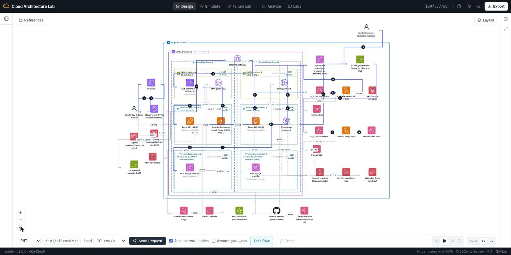

### 8.1 Results

| Scenario | How I ran it | Result |
|---|---|---|
| Walkthrough 1: open exam + autosave | `PUT /api/attempts/demo/answers` from Students, 10 req/s | **HTTP 202 in 147 ms, 12 steps.** Route 53 → CloudFront (cache miss for the dynamic route) → IGW → ALB → Exam API → DynamoDB write → marking job queued on SQS → response |
| Walkthrough 2: 40 MB upload | `POST` from the student's browser straight to S3 | **HTTP 202 in 40 ms, 6 steps.** S3 → SQS upload events → Lambda event source mapping → Lambda notify tutor processes and deletes the message |
| Exam peak | Walkthrough 1 at **100× spike** | **HTTP 202 in 147 ms**, no bottleneck flagged. The lab's cost estimate rises to $3,618.06/month at that load |
| Loss of AZ-A | Failure Lab → AZ-A outage, then walkthrough 1 | 3 resources failed (Exam API AZ-A, NAT gateway A, RDS primary). 5 dependents survived through redundancy. The ALB health check removed the AZ-A target and routed to **Exam API (AZ-B)**: **HTTP 202** |
| Loss of AZ-B | Failure Lab → AZ-B outage, then walkthrough 1 | 3 resources failed (Exam API AZ-B, NAT gateway B, RDS standby). 4 dependents survived. Traffic went to **Exam API (AZ-A)**: **HTTP 202** |

### 8.2 What the lab caught

My first walkthrough 1 run **failed with HTTP 403**. The lab checks IAM, and the API servers had no role, so `dynamodb:GetItem` was denied before any policy was even evaluated. I fixed it by attaching least-privilege roles:

| Role | Allowed |
|---|---|
| `exam-api-role` (EC2) | `dynamodb:GetItem/PutItem/Query` on the answers table, `sqs:SendMessage` on the marking queue, `s3:PutObject/GetObject` on `uploads/*`, `s3:ListBucket`, `secretsmanager:GetSecretValue` on the DB secret |
| `auto-mark-lambda-role` | DynamoDB on the answers table, receive/delete on the marking queue |
| `notify-tutor-lambda-role` | `sns:Publish` on the tutor topic, receive/delete on the upload queue |

After that, every request step showed "Allowed: identity policy exam-api-role-policy…". This is the same rule real AWS applies: a server with no role can't call DynamoDB at all.

The lab also only accepts connections it has a rule for. For example, SQS → Lambda has to be a `Message` connection, and Students → Cognito has no rule. Cognito, SES, the two DLQs, WAF, ACM, the NAT gateways, AWS Backup and CloudTrail are therefore drawn as *configuration links*: they're in the design, but the simulator doesn't send traffic through them.

### 8.3 Limits of the simulation

These are simulations of the design's behaviour, not measurements from a live deployment. The latencies are the lab's model. Walkthrough 1 writes answers to DynamoDB, so the RDS failover appears in the impact analysis ("RDS MySQL primary is Multi-AZ … automatically fails over") rather than as a step in the request.

## 9. Evidence: screenshots

| # | Step | Screenshot |
|---|---|---|
| 1 | Project files after unzipping | 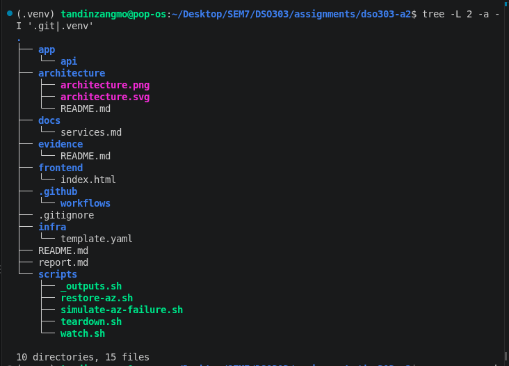 |
| 2 | Template validated with cfn-lint | 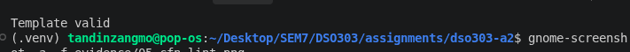 |
| 3 | API code checked | 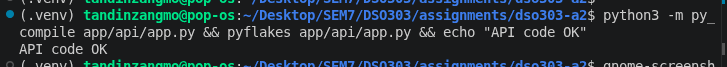 |
| 4 | Commit history | 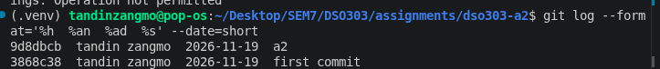 |
| 5 | Remote and push status | 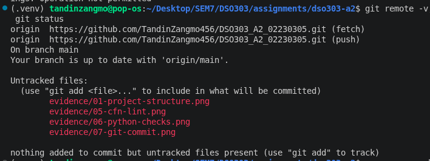 |
| 6 | Cloud Architecture Lab: full design |  |
| 7 | Lab: walkthrough 1, open exam + autosave (HTTP 202) | 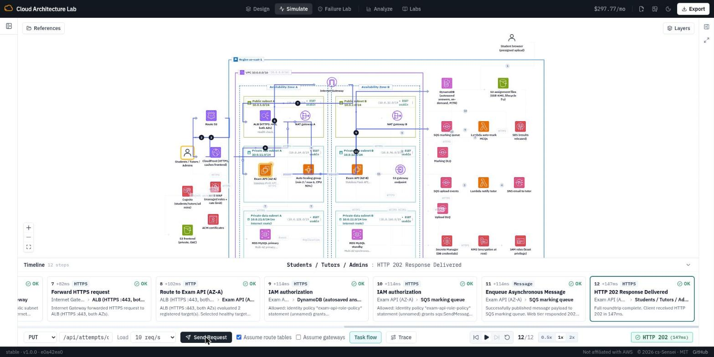 |
| 8 | Lab: walkthrough 2, 40 MB upload → tutor notified (HTTP 202) | 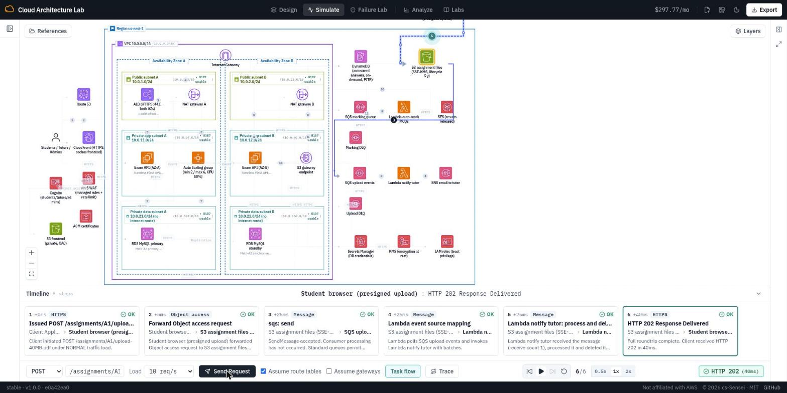 |
| 9 | Lab: exam peak at 100× spike (HTTP 202) | 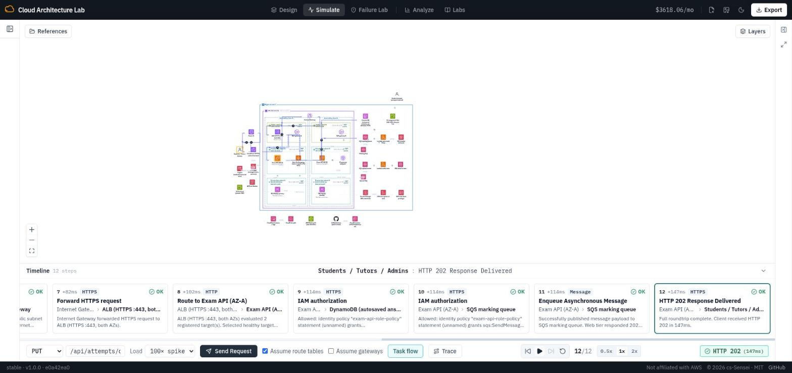 |
| 10 | Lab: AZ-A outage, traffic moved to AZ-B (HTTP 202) |  |
| 11 | Lab: AZ-B outage, traffic moved to AZ-A (HTTP 202) | 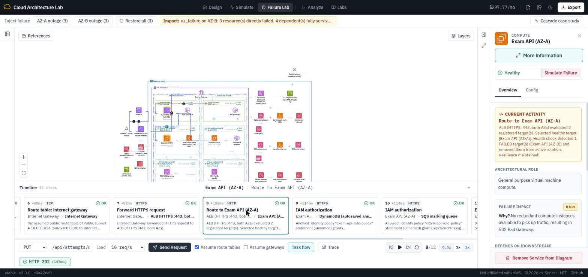 |

## 10. Limitations

- **Not deployed to AWS.** The walkthroughs and AZ failures were simulated in the Cloud Architecture Lab (section 8), but I did not deploy the stack to a live AWS account, so there are no AWS Console screenshots. The template, pipeline and failure-simulation scripts are ready, and adding AWS credentials to the repository secrets would deploy it on the next push.
- **Template vs full design.** A few production parts are documented but left out of the template because they need a registered domain or account features I didn't have: Route 53, an ACM certificate on the ALB, SES and per-component IAM roles. The repository README explains each one.

## 11. Conclusion

The design meets every target in the brief using managed AWS services across two AZs. The two techniques that matter most are keeping the API servers stateless and moving slow or bursty work (autosaves, uploads, marking, emails) onto services that absorb load on their own. The lab also showed why least privilege has to be designed in: without a role on the API servers, the first request was denied. The most useful thing I learned was reasoning from the numbers: 10 starts per second, 100 writes per second and 50 MB files each pointed to a specific design choice, instead of adding services because they are common.